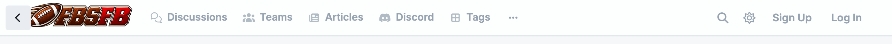
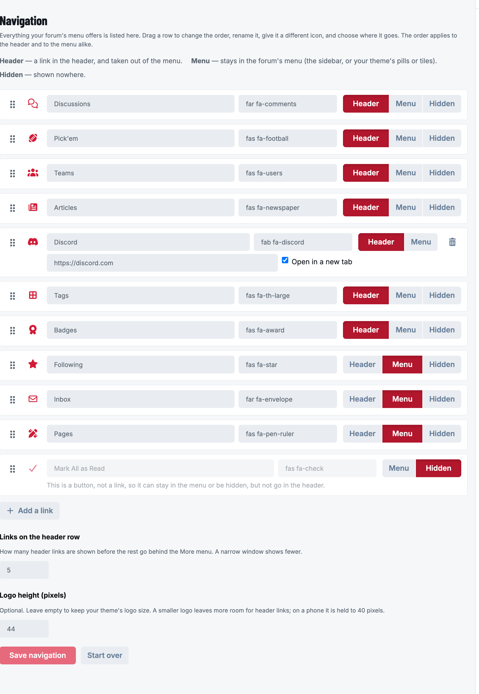
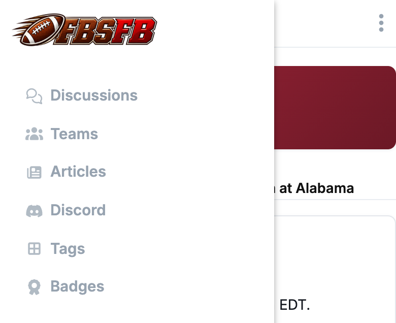
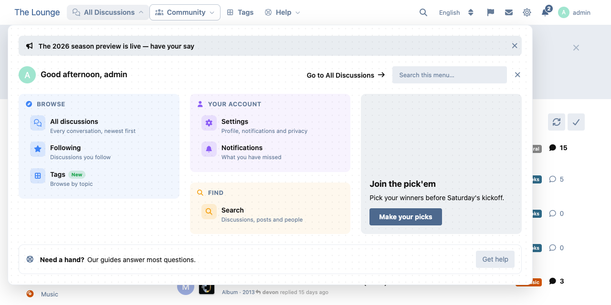
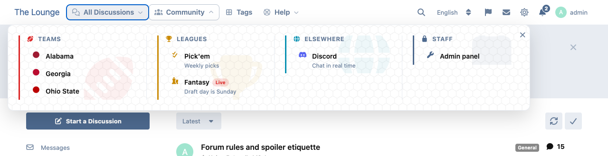
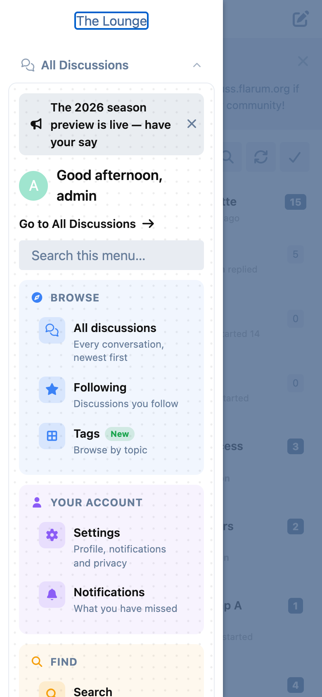
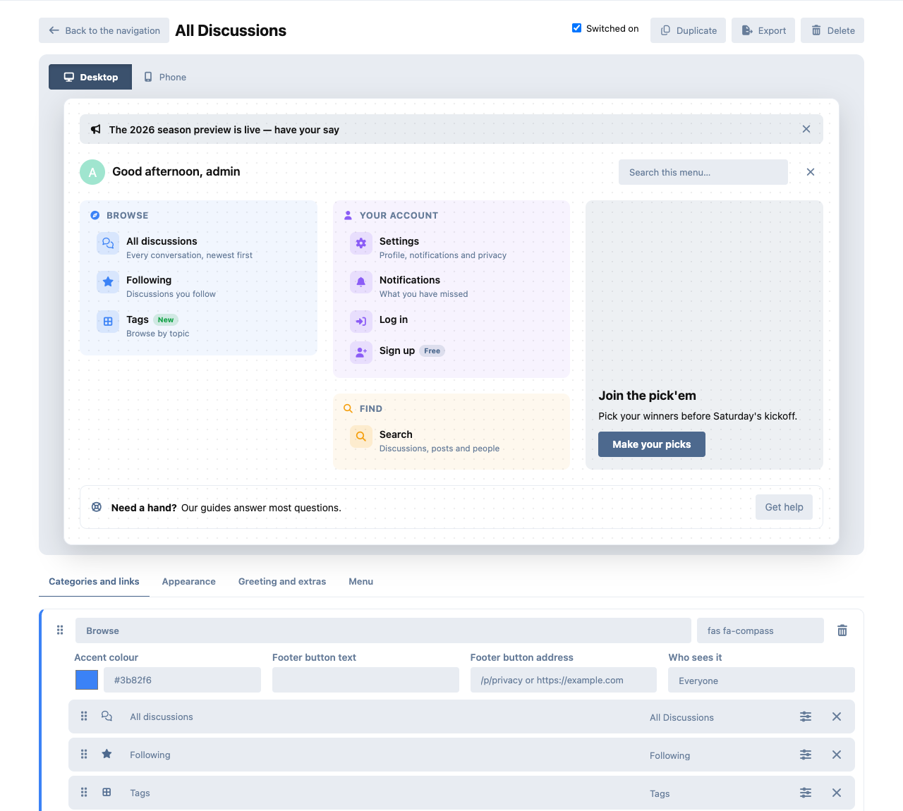

# Header Nav

Put your forum's navigation in the header, and decide what goes where.

Flarum 2. Works with the default theme and with themes that draw the menu as
pills or tiles (Bespoke, GridIron Nation and others), because it changes the
menu itself rather than any one theme's markup.



## What you can do

Open **Admin → Header Nav → Open the navigation editor**. The editor opens on
the forum, and lists everything your forum's menu offers: All Discussions,
Following, Tags, Messages, and whatever your extensions add (a pick'em, a
knowledge base, a gallery…). For each one:

- **Where it goes.** *Header* puts it in the header and takes it out of the
  menu. *Menu* leaves it in the sidebar, or in your theme's pills or tiles.
  *Hidden* removes it everywhere — for example, "All Discussions" when your
  forum's home is the tags page.
- **Rename it.** Leave the name empty to keep the original.
- **Change its icon.** Any Font Awesome class, such as `fas fa-home`.
- **Drag it into order.** The order applies to the header and to the menu.



You can also **add your own links** — a privacy notice, your main site, a
Discord — to the header or the menu, opening in the same tab or a new one.

And choose **how many links sit on the header row** before the rest go behind
**More**. A narrow window shows fewer; on a phone they are all in the drawer.

Changes show in the header as soon as you save.



## Mega menus

A header link can open a **mega menu**: a card of categories and links under
the header, instead of going straight to a page.



In the navigation editor, press **Mega menu** on a header link to give it one,
or **Add a mega menu** for a header item of its own. Each menu opens in a
builder with a live preview of the desktop card and the phone version:

- **Categories and links.** Up to 6 categories, each with up to 30 links. Drag
  the handles to reorder categories, and to move links within a category or
  into another one. The handles also work with the arrow keys. A category can
  be stacked under the one before it.
- **Where a link goes.** An address on your forum, any `http(s)` address or
  `mailto:`, or a built-in destination: anything in your forum's menu
  (including pages your extensions add), a tag, Search, Settings,
  Notifications, Log in and Sign up. Links that don't apply to a visitor, such
  as Log in for someone already logged in, are left out for them.
- **Each link** can have a description, an icon and icon colour, a badge in a
  colour of your choice, and can open in a new tab.
- **Appearance.** Seven styles (Classic, Soft cards, Accent rails, Raised
  cards, Header bands, Underlined headings, Inset panels), title bands, icon
  tiles, compact or comfortable spacing, width, columns, borders, shadows,
  dividers, separators, a faint category-icon watermark, and 13 textures with
  a strength slider. Menus use your forum's own colours, light and dark.
- **Extras.** A greeting with the visitor's avatar ("Good morning, Ernest", by
  the visitor's own clock) and one for guests, a search field that filters the
  menu, an announcement visitors can dismiss, a promotion with an optional
  background image, and a help block.
- **Who sees it.** Everyone, guests, members or chosen groups, for a whole
  menu, a category, a link or the promotion. Your forum only sends visitors
  the parts they're allowed to see.
- **How it opens.** On hover or click, or on click only. The header item can
  look like your other header links or like an outlined button.
- **Duplicate, export and import** a menu as a JSON file, and switch a menu
  off without deleting it.



On a phone, the menus are in the drawer with your other header links, and open
in place. When the header runs out of room, they work the same way inside the
**More** menu. Escape closes a menu and puts you back on its link. The arrow
down key opens it and takes you to its search field or first link.





The menus open instantly and the builder only loads for admins. A forum that
has no mega menus sends and loads nothing extra.

## Good to know

- **Nothing is linked into existence.** An entry belongs to the extension that
  provides it. Disable that extension and the entry disappears from the header
  too, instead of becoming a link that goes nowhere; enable it again and it
  comes back where you put it.
- **New extensions are never lost.** Anything a new extension adds to the menu
  after you saved stays in the menu, where that extension put it, until you
  move it.
- **Buttons stay buttons.** A menu entry that is not a link, such as "Mark all
  as read", can be kept in the menu or hidden, but not put in the header.
- **Only safe addresses.** A custom link must be a path on your forum
  (`/p/privacy`), an `http(s)` address or `mailto:`. Anything else is refused,
  and so is a mega menu colour that isn't a colour.
- **Before you save anything**, the header starts with the common destinations
  your forum has — discussions, a pick'em, a roster, a knowledge base, an issue
  tracker, articles, a gallery, badges, tags and hashtags, whichever exist —
  and everything else stays in the menu.

## Installation

```bash
composer require ernestdefoe/header-nav
php flarum cache:clear
```

Then enable **Header Nav** in the admin panel.

## Updating

```bash
composer update ernestdefoe/header-nav
php flarum cache:clear
```

## Support

- **Support forum:** [Header Nav on ernestdefoe.online](https://ernestdefoe.online/d/105)
- **Flarum community:** [Header Nav on discuss.flarum.org](https://discuss.flarum.org/d/39984-header-nav)
- **Bug reports:** [GitHub issues](https://github.com/ernestdefoe/header-nav/issues)

## Licence

MIT.
